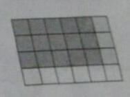

# Mathematics (Grade 3)

**ID**: 465ec0b1
**难度**: medium_hard
**题型**: multiple_choice

## 题目
根据下图列算式是(    )．
$A.\frac{3}{4}×\frac{5}{6}$
$B.\frac{4}{5}×\frac{3}{5}$
$C.\frac{1}{3}×\frac{5}{6}$

## 解答

**答案**: A

1. Step1:观察图形，发现图形先被平均分成了4份，取其中3份，这部分可表示为$\frac{3}{4}$
2. Step2:再看取的这$\frac{3}{4}$部分，又被平均分成了6份，取其中5份，这部分可表示为$\frac{5}{6}$
3. Step3:根据上述分析，阴影部分的面积为$\frac{3}{4}×\frac{5}{6}$，对应选项A

## 知识点

**知识点**:
  - --

---
