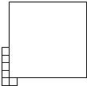

# Mathematics (Grade 3)

**ID**: 46daad15
**难度**: medium_hard
**题型**: multiple_choice

## 题目
有一块边长1米的正方形地，要在它的四周（外侧）铺满面积为1平方分米的正方形瓷砖（如图），共需要（  ）块正方形砖．
$\begin{description}
\item A．40\item B．44\item C．48\item D．60
\end{description}$

## 解答

**答案**: B

1. Step1:将正方形地的边长单位换算成分米，因为1米 = 10分米
2. Step2:计算正方形地每条边不考虑角上瓷砖时能铺的瓷砖数，10÷1 = 10块
3. Step3:计算四条边不考虑角上瓷砖时能铺的瓷砖总数，10×4 = 40块
4. Step4:加上四个角上的4块瓷砖，40 + 4 = 44块
5. Step5:得出共需要44块正方形砖，答案选B

## 知识点

**知识点**:
  - 长方形、正方形的面积．

---
