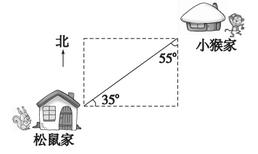

# Mathematics (Grade 3)

**ID**: 499e0f0b
**难度**: medium_hard
**题型**: multiple_choice

## 题目
如图，以小松鼠家为观测点，小猴家在（）

A.东偏北35°
B.北偏东35°
C.南偏西35°

## 解答

**答案**: A

1. Step1:明确观测点为小松鼠家
2. Step2:根据上北下南左西右东，判断小猴家在小松鼠家右上角，得出是东偏北方向
3. Step3:从图中找到东偏北的角度为35°
4. Step4:得出以小松鼠家为观测点，小猴家在东偏北35°，答案选A

## 知识点

**知识点**:
  - 方向与位置

---
