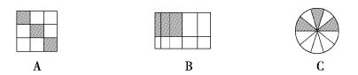

# Mathematics (Grade 3)

**ID**: 4dfa3fef
**难度**: medium_hard
**题型**: multiple_choice

## 题目
下面图中的涂色部分可以用0.3表示的是（）。

## 解答

**答案**: C

1. Step1:明确0.3表示把一个整体平均分成10份，取其中的3份
2. Step2:分析A选项，图形被平均分成9份，不符合平均分成10份的要求，所以不能用0.3表示
3. Step3:分析B选项，图形没有平均分，不满足表示小数的条件，所以不能用0.3表示
4. Step4:分析C选项，图形平均分成了10份，阴影部分占3份，符合0.3的意义，所以可以用0.3表示

## 知识点

**知识点**:
  - 小数的读法和写法

---
