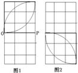

# Mathematics (Grade 3)

**ID**: 4ee7b09c
**难度**: medium_hard
**题型**: multiple_choice

## 题目
由图形1不能变为图形2的方法是（  ）
A．图形1绕O点逆时针方向旋转90°得到图形2
B．图形1绕O点顺时针方向旋转90°得到图形2
C．图形1以线段OP为对称轴画图形1的轴对称得到图形2

## 解答

**答案**: A

1. Step1:观察图形1和图形2，确定可通过旋转或轴对称的方式尝试从图形1得到图形2
2. Step2:分析选项A，判断图形1绕O点逆时针方向旋转90°是否能得到图形2，发现不能得到
3. Step3:分析选项B，判断图形1绕O点顺时针方向旋转90°是否能得到图形2，发现能得到
4. Step4:分析选项C，判断图形1以线段OP为对称轴画图形1的轴对称是否能得到图形2，发现能得到
5. Step5:根据上述分析，得出由图形1不能变为图形2的方法是选项A

## 知识点

**知识点**:
  - 将简单图形平移或旋转一定的度数．

---
