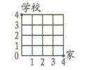

# Mathematics (Grade 3)

**ID**: 588e55d9
**难度**: medium_hard
**题型**: multiple_choice

## 题目
小华从家出发到学校经过的街道如图所示，如果用（4，0）表示家的位置，那么下面的路径中，不能到达学校的是（    ）。

 学校 家
 （A）（4，0）→（4，4）→（0，4）
 （B）（4，0）→（0，0）→（0，4）
 （C）（4，0）→（1，0）→（1，4）

## 解答

**答案**: C

1. Step1:明确家的位置为（4，0），学校在图中左上角位置
2. Step2:分析选项A，（4，0）→（4，4）→（0，4），先向上移动到（4，4），再向左移动到（0，4），能到达学校附近区域
3. Step3:分析选项B，（4，0）→（0，0）→（0，4），先向左移动到（0，0），再向上移动到（0，4），能到达学校附近区域
4. Step4:分析选项C，（4，0）→（1，0）→（1，4），先向左移动到（1，0），再向上移动到（1，4），不能到达学校位置

## 知识点

**知识点**:
  - 图形与几何;图形与位置

---
