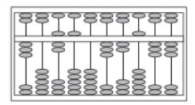

# Mathematics (Grade 3)

**ID**: 5b8e7ef1
**难度**: medium_hard
**题型**: multiple_choice

## 题目
算盘上表示的数是（）（右起第一位为个位）

A.3075032533
B.3031032133
C.3071032133

## 解答

**答案**: A

1. Step1:明确右起第一位为个位，从右往左依次确定各个数位上珠子表示的数。个位上有三颗下珠，表示3个一。
2. Step2:十位上有三颗下珠，表示3个十。
3. Step3:百位上有一颗上珠，表示5个百。
4. Step4:千位上有两颗下珠，表示2个千。
5. Step5:万位上有三颗下珠，表示3个万。
6. Step6:十万位上没有珠子，用0表示。
7. Step7:百万位上有三颗下珠，表示3个百万。
8. Step8:千万位上没有珠子，用0表示。
9. Step9:亿位上有七颗下珠，表示7个亿。
10. Step10:十亿位上有三颗下珠，表示3个十亿。
11. Step11:将各个数位上表示的数组合起来，得到3075032533，所以答案选A。

## 知识点

**知识点**:
  - 万以上数的认识

---
