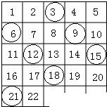

# Mathematics (Grade 3)

**ID**: 5e82e9fc
**难度**: medium_hard
**题型**: multiple_choice

## 题目
在下面的数表中，每隔两个数后的第三个数就会被圈起来．如果按照相同的方式继续圈下去，下列（  ）应该被圈起来．
$\begin{description}
\item A．100\item B．101\item C．102\item D．103
\end{description}$

## 解答

**答案**: C

1. Step1:分析题目可知，数表中每隔两个数后的第三个数被圈起来，由此可推出被圈起来的数的规律是为3的整数倍
2. Step2:分别计算选项A中100各位数字之和，1 + 0 + 0 = 1，1不能被3整除，所以100不是3的整数倍
3. Step3:分别计算选项B中101各位数字之和，1 + 1 = 2，2不能被3整除，所以101不是3的整数倍
4. Step4:分别计算选项C中102各位数字之和，1 + 2 = 3，3能被3整除，所以102是3的整数倍
5. Step5:分别计算选项D中103各位数字之和，1 + 3 = 4，4不能被3整除，所以103不是3的整数倍
6. Step6:根据上述计算，只有102是3的整数倍，所以应该被圈起来的是102，答案选C

## 知识点

**知识点**:
  - 数表中的规律．

---
