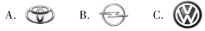

# Mathematics (Grade 3)

**ID**: 5f65f503
**难度**: medium_hard
**题型**: multiple_choice

## 题目
下面是几种汽车标志，其中不是轴对称图形的是（）

## 解答

**答案**: B

1. Step1:明确轴对称图形的判断标准为能否沿一条直线对折后两边图形完全重合
2. Step2:观察选项A中的图形，发现沿竖直方向过图形中心的直线对折后左右两部分重合，所以是轴对称图形
3. Step3:观察选项B中的图形，发现不存在这样一条直线使对折后两边图形重合，所以不是轴对称图形
4. Step4:观察选项C中的图形，发现沿竖直方向过图形中心的直线对折后左右两部分重合，所以是轴对称图形
5. Step5:根据上述判断，得出不是轴对称图形的是B

## 知识点

**知识点**:
  - 轴对称图形的定义

---
