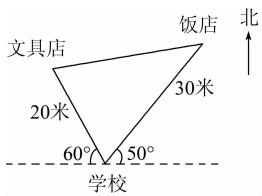

# Mathematics (Grade 3)

**ID**: 63886257
**难度**: medium_hard
**题型**: multiple_choice

## 题目
饭店在学校的（）
A.东偏西50°方向30米
B.东偏北50°方向30米
C.西偏北50°方向30米
D.南偏北50°方向30米

## 解答

**答案**: B

1. Step1:明确以学校为观测点
2. Step2:依据'上北下南、左西右东'，从学校看饭店，饭店在学校东边且向北偏移，所以方向是东偏北
3. Step3:结合图形，确定偏移角度为50°
4. Step4:根据图形得出饭店与学校的距离是30米
5. Step5:综合以上信息，饭店在学校的东偏北50°方向30米，答案选B

## 知识点

**知识点**:
  - 根据方向和距离确定位置

---
