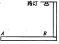

# Mathematics (Grade 3)

**ID**: 6c2c10db
**难度**: medium_hard
**题型**: multiple_choice

## 题目
如图，晚上小亮在路灯下散步，他从A处向路灯柱方向径直走到B处，这一过程中，他在该路灯灯光下的影子（   ）。

A．逐渐变短
B．逐渐变长
C．先变短后变长
D．先变长后变短

## 解答

**答案**: A

1. Step1:明确本题考查物体在光源下移动时影子的变化情况
2. Step2:确定影子变化规律为物体离光源越远，影子越长；物体离光源越近，影子越短
3. Step3:分析小亮从A处走向B处是离路灯越来越近
4. Step4:根据影子变化规律得出小亮的影子会越来越短，即逐渐变短，所以选A

## 知识点

**知识点**:
  - 

---
