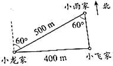

# Mathematics (Grade 3)

**ID**: 6d82704f
**难度**: medium_hard
**题型**: multiple_choice

## 题目
观察图中的信息，可以获得不同的结论，下面的结论中，正确的是（  ）

$\begin{description}
\item A．小龙从家里出发，向北偏东60°方向走500米，就到达小雨家．\item B．小雨从家里出发向北偏西方向走500米就可以到达小龙家．\item C．小雨和小飞家的距离一定不超过100米．
\end{description}$

## 解答

**答案**: A

1. Step1:根据图中信息及方向规则，小龙家到小雨家距离为500米，且小龙从家里出发，是向北偏东60°方向走500米到达小雨家，所以A选项正确。
2. Step2:小雨从家里出发应是向南偏西60°方向走500米到达小龙家，而不是向北偏西方向，所以B选项错误。
3. Step3:图中未明确表明小雨和小飞家的距离一定不超过100米，无法得出此结论，所以C选项错误。

## 知识点

**知识点**:
  - 

---
