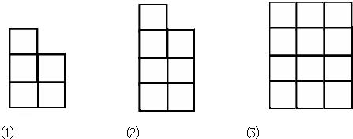

# Mathematics (Grade 3)

**ID**: 6e3fa5b5
**难度**: medium_hard
**题型**: multiple_choice

## 题目
有一些大小相同的正方体木块堆成一堆，从上往下看如图（1），从前往后看如图（2），从左往右看如图（3），这堆木块最少有 （  ）块．

A．20
B．18
C．16
D．15

## 解答

**答案**: C

1. Step1:根据图（1）、图（2）可知，从正面看，左列至少有一行是4层，右列至少有1行是3层
2. Step2:依据图（1）、图（3）可知，从正面看至少有1列是4层
3. Step3:计算木块最少数量，前面三列按每行4个，共3×4个，再加上后面右列单独的3个和最右边单独的1个，即3×4 + 3 + 1 = 16块

## 知识点

**知识点**:
  - 从不同方向观察物体和几何体．

---
