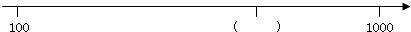

# Mathematics (Grade 3)

**ID**: 6f0d2559
**难度**: medium_hard
**题型**: multiple_choice

## 题目
根据图中想一想，括号内大约填（  ）

A．500
B．600
C．700
D．800

## 解答

**答案**: C

1. Step1:计算数轴上100到1000的数值差，1000 - 100 = 900
2. Step2:判断括号内的数大约在数轴从100到1000的$\frac{2}{3}$的位置
3. Step3:计算括号内的数值，900×$\frac{2}{3}$ + 100 = 700
4. Step4:得出括号内应填700，对应选项C

## 知识点

**知识点**:
  - 数的估算．

---
