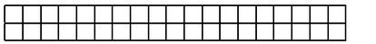

# Mathematics (Grade 3)

**ID**: 74462101
**难度**: medium_hard
**题型**: multiple_choice

## 题目
下面是一个2行19列的网格图，如果给每个格子里涂上红、黄、蓝三色中的任意一色，无论怎么涂，至少有（）列的涂法是相同。

A.2
B.3
C.4
D.5

## 解答

**答案**: B

1. Step1:分析每个格子涂红、黄、蓝三色中任意一色的情况，得出每列两个格子的涂色情况有红红、黄黄、蓝蓝、黄红、蓝红、蓝黄，共6种
2. Step2:将这6种涂色情况看作6个抽屉，19列看作19个元素
3. Step3:用元素总数19除以抽屉数6，即19÷6=3（组）……1（列）
4. Step4:根据抽屉原理，得出至少有3列的涂法是相同，所以答案选B

## 知识点

**知识点**:
  - 抽屉原理(奥数)

---
