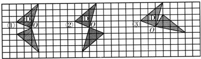

# Mathematics (Grade 3)

**ID**: 79d926b3
**难度**: medium_hard
**题型**: multiple_choice

## 题目
把图D绕点0顺时针旋转180°，下面旋转正确的是（  ）

A．①
B．②
C．③

## 解答

**答案**: B

1. Step1:分析选项A，①是图形D向下翻转后得到的，不符合绕点0顺时针旋转180°的要求
2. Step2:分析选项B，②是图形D绕点0顺时针旋转180°得到的，符合要求
3. Step3:分析选项C，③是图形D绕点0顺时针旋转90°后得到的，不符合绕点0顺时针旋转180°的要求
4. Step4:综上，正确答案是B

## 知识点

**知识点**:
  - 将简单图形平移或旋转一定的度数．

---
