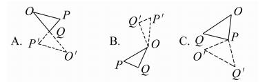

# Mathematics (Grade 3)

**ID**: 7a2086f5
**难度**: medium_hard
**题型**: multiple_choice

## 题目
下面的图形中，是以点O为中心旋转的有（）

## 解答

**答案**: B

1. Step1:分析选项A，根据旋转中心的判断方法，可知其是以Q为中心旋转的
2. Step2:分析选项B，按照旋转中心的判断，得出其是以O为中心旋转的
3. Step3:分析选项C，通过对旋转中心的判断，得到其是以P为中心旋转的
4. Step4:根据题目要求找出以点O为中心旋转的图形，确定是选项B

## 知识点

**知识点**:
  - 旋转

---
