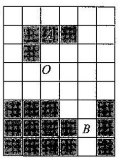

# Mathematics (Grade 3)

**ID**: 7b18f016
**难度**: medium_hard
**题型**: multiple_choice

## 题目
如图，小明玩俄罗斯方块游戏，下面的（    ）表示了他将图A摆放到图B处的方法．

 A．图A先向右平移1格，向下平移2格，再绕点逆时针旋转90°
 B．图A先向下平移3格，向右平移1格，再绕点逆时针旋转90°
 C．图A先绕点O顺时针旋转90°再向右平移格，向下平移2格
 D．图A先绕点O顺时针旋转90°再向右平移格，向下平移3格

## 解答

**答案**: B

1. Step1:观察图A和图B的位置关系，发现需要对图A进行旋转、平移操作才能摆放到图B处。
2. Step2:分析选项A，先向右平移1格，向下平移2格，再绕点逆时针旋转90°，与图A到图B的实际变换不符。
3. Step3:分析选项B，先向下平移3格，向右平移1格，再绕点逆时针旋转90°，符合图A到图B的变换情况。
4. Step4:分析选项C，先绕点O顺时针旋转90°再向右平移格（未明确格数），向下平移2格，与实际变换不符。
5. Step5:分析选项D，先绕点O顺时针旋转90°再向右平移格（未明确格数），向下平移3格，虽然旋转方向正确，但平移描述不准确，且整体不如选项B符合变换情况。
6. Step6:综上，确定答案为选项B。

## 知识点

**知识点**:
  - 总复习-图形与几何验收标准检测

---
