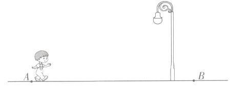

# Mathematics (Grade 3)

**ID**: 80182d15
**难度**: medium_hard
**题型**: multiple_choice

## 题目
如图，晚上小亮在路灯下散步，在小亮由A点走向B点的过程中，他在地上的影子（）.

A.逐渐变短
B.逐渐变长
C.先变短再变长
D.先变长再变短

## 解答

**答案**: C

1. Step1:明确本题考查中心投影的相关知识，且影子长度与物体长度和物体到光源的距离有关
2. Step2:分析小亮由A点走向B点的过程中离路灯距离的变化情况，可知是先变小后变大
3. Step3:根据中心投影影长的变化规律，得出小亮在地上的影子先变短再变长
4. Step4:从选项中找到符合影子先变短再变长这一结论的选项，即C选项

## 知识点

**知识点**:
  - 中心投影

---
