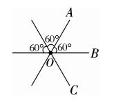

# Mathematics (Grade 3)

**ID**: 80c25ab3
**难度**: medium_hard
**题型**: multiple_choice

## 题目
将C线逆时针旋转（），可以和A线重合。

A.120°
B.90°
C.60°

## 解答

**答案**: A

1. Step1:观察图形，确定图中每一个基本角的度数都是60°
2. Step2:明确要将C线逆时针旋转和A线重合，需旋转2个基本角
3. Step3:计算旋转角度为60°×2 = 120°
4. Step4:根据计算结果，在选项中选择A

## 知识点

**知识点**:
  - 旋转

---
