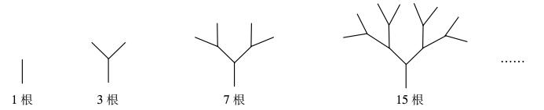

# Mathematics (Grade 3)

**ID**: 8356a48c
**难度**: medium_hard
**题型**: multiple_choice

## 题目
红红按照一定的规律用小棒摆出了下面的4幅图：

如果按照这个规律继续摆，第5幅图要用（）棵小棒。
A.23
B.31
C.35
D.45

## 解答

**答案**: B

1. Step1:观察图形，发现规律为后面每个图形中小棒的根数等于前一幅图中小棒根数的2倍多1根
2. Step2:第2幅图中小棒根数为1×2+1=3根
3. Step3:第3幅图中小棒根数为3×2+1=7根
4. Step4:第4幅图中小棒根数为7×2+1=15根
5. Step5:根据规律，第5幅图中小棒根数为15×2+1=31根
6. Step6:答案选项中B为31，所以答案是B

## 知识点

**知识点**:
  - 图形中的规律

---
