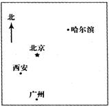

# Mathematics (Grade 3)

**ID**: 84e155b7
**难度**: medium_hard
**题型**: multiple_choice

## 题目
观察图，下面说法不正确的是(  )

A．广州在北京的南方
B．哈尔滨在北京的东北方
C．西安的东南方是广州
D．西安的西南方是广州

## 解答

**答案**: D

1. Step1:根据地图上“上北下南，左西右东”的方向辨别方法，观察图中广州和北京的位置关系，判断广州在北京的南方，所以选项A正确
2. Step2:同样依据“上北下南，左西右东”，观察哈尔滨和北京的位置，得出哈尔滨在北京的东北方，选项B正确
3. Step3:按照“上北下南，左西右东”，查看西安和广州的位置，可知西安的东南方是广州，选项C正确
4. Step4:依据“上北下南，左西右东”，观察发现西安的西南方不是广州，选项D错误

## 知识点

**知识点**:
  - 方向．

---
