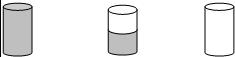

# Mathematics (Grade 3)

**ID**: 853c7345
**难度**: medium_hard
**题型**: multiple_choice

## 题目
一杯水连杯重380克，半杯水连杯重280克，一个空杯重多少克？（  ）

$\begin{description}
\item A．100克\item B．180克\item C．280克
\end{description}$

## 解答

**答案**: B

1. Step1:计算半杯水的重量，用一杯水连杯的重量380克减去半杯水连杯的重量280克，即380 - 280 = 100克
2. Step2:计算空杯的重量，用半杯水连杯的重量280克减去半杯水的重量100克，即280 - 100 = 180克
3. Step3:得出空杯重180克，对应选项B

## 知识点

**知识点**:
  - 整数、小数复合应用题．

---
