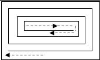

# Mathematics (Grade 3)

**ID**: 8caaefa3
**难度**: medium_hard
**题型**: multiple_choice

## 题目
如图，是一个长16米、宽10米的长方形园地，其中充满1米宽的小路，如果你沿着小路的中心，从内部出发，走完这条小路，要走(  )
A．52米
B．80米
C．104米
D．160米

## 解答

**答案**: D

1. Step1:明确已知条件，长方形园地长为16米、宽为10米，小路宽1米
2. Step2:根据解析2可知，需先求出长方形园地的面积，根据长方形面积公式S = 长×宽，可得面积为16×10 = 160平方米
3. Step3:再根据解析2，用长方形园地的面积除以小路的宽，即160÷1 = 160米，得到走完这条小路要走的长度

## 知识点

**知识点**:
  - 巧算周长．

---
