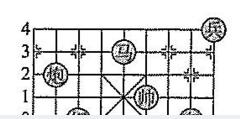

# Mathematics (Grade 3)

**ID**: 8f9754cf
**难度**: medium_hard
**题型**: multiple_choice

## 题目
如图是中国象棋棋盘的一部分，若“帅”位于(5,1)位置，“车”位于(7,0)位置，那么“马”的位置是(    ).
 A.(1，2)
 B.(4，3)
 C.(8，4)

## 解答

**答案**: B

1. Step1:根据“帅”位于(5,1)位置、“车”位于(7,0)位置，确定y轴为从左向右数为正向，x轴为从下往上数为正向
2. Step2:依据上述确定的坐标系方向，找到“马”在从左向右数第4列，从下往上数第3行
3. Step3:得出“马”的位置是(4,3)，所以答案选B

## 知识点

**知识点**:
  - 全真模拟训练密卷-重点学校卷（四）
-

---
