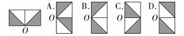

# Mathematics (Grade 3)

**ID**: 91d3aca0
**难度**: medium_hard
**题型**: multiple_choice

## 题目
将下面的图案绕点“O”按顺时针方向旋转90°，得到的图案是（）

## 解答

**答案**: B

1. Step1:明确旋转的性质，即旋转不改变物体的形状和大小
2. Step2:对选项A进行分析，判断其是否改变了物体的形状，发现其改变了物体形状
3. Step3:对选项B进行分析，判断其是否改变了物体的形状和大小，发现其没有改变
4. Step4:对选项C进行分析，判断其是否改变了物体的形状，发现其改变了物体形状
5. Step5:对选项D进行分析，判断其是否改变了物体的形状，发现其改变了物体形状
6. Step6:根据上述分析，得出符合绕点‘O’按顺时针方向旋转90°且形状和大小不变的图案是B

## 知识点

**知识点**:
  - 旋转

---
