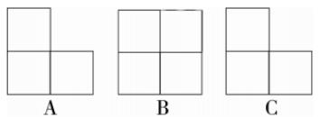

# Mathematics (Grade 3)

**ID**: 982d5ca7
**难度**: medium_hard
**题型**: multiple_choice

## 题目
将几个大小相同的正方体放在一起，从正面看到的形状是图A，从左面看到的形状是图B，从上面看到的形状是图C，则这些正方体木块有（）个。

## 解答

**答案**: 5

1. Step1:根据解析2，从左面看到的图形可知该组合体有两层，可以看到4个正方体木块
2. Step2:根据解析2，把从上面与从正面看到的图形结合起来，可得出除了从左面看到的4个正方体木块外，还有1个正方体木块
3. Step3:将从左面看到的正方体木块数量4与额外的1个正方体木块相加，即4 + 1 = 5个，得到正方体木块的总个数

## 知识点

**知识点**:
  - 从不同方向观察物体

---
