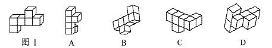

# Mathematics (Grade 3)

**ID**: 9a9915b8
**难度**: medium_hard
**题型**: multiple_choice

## 题目
图1是一个标准图形，下面（）旋转后的图形和标准图形完全相同。

## 解答

**答案**: B

1. Step1:明确题目要求是找出旋转后和标准图形完全相同的图形
2. Step2:依据旋转的定义，即把一个图形绕着某一点转动一个角度的图形变换叫做旋转，旋转时图形位置发生变化，大小不变，形状不变
3. Step3:对选项A图形进行尝试旋转，发现旋转后无法得到与标准图形完全相同的图形
4. Step4:对选项B图形进行旋转，发现将其旋转180°，可得到与标准图形完全相同的图形
5. Step5:对选项C图形进行尝试旋转，发现旋转后无法得到与标准图形完全相同的图形
6. Step6:对选项D图形进行尝试旋转，发现旋转后无法得到与标准图形完全相同的图形
7. Step7:得出答案为B

## 知识点

**知识点**:
  - 图形的旋转

---
