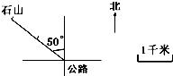

# Mathematics (Grade 3)

**ID**: a124d149
**难度**: medium_hard
**题型**: multiple_choice

## 题目
石山在
公路的(  )处．
A．西偏北50°，距公路2千米
B．北偏西50°，距公路2千米
C．东偏北50°，距公路2千米

## 解答

**答案**: B

1. Step1:根据图上距离1厘米表示实际距离1千米，从图中可知公路与石山的图上距离为2厘米，所以实际距离为2×1=2千米
2. Step2:依据地图上“上北下南，左西右东”的方向辨别方法以及图上标注的50°信息，可判断出石山在公路的北偏西50°
3. Step3:结合前面得出的距离和方向信息，可知石山在公路的北偏西50°，距公路2千米，所以答案选B

## 知识点

**知识点**:
  - 方向;根据方向和距离确定物体的位置．

---
