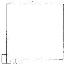

# Mathematics (Grade 3)

**ID**: a54e2245
**难度**: medium_hard
**题型**: multiple_choice

## 题目
(2011•北京模拟)有一块边长1米的正方形地，在它的四周铺满面积1平方分米的正方形砖(如图)．需(  )块正方形砖． 

A．36
B．40
C．44
D．100  E.104

## 解答

**答案**: C

1. Step1:将大正方形地的边长单位由米换算为分米，因为1米 = 10分米，所以大正方形边长为10分米
2. Step2:根据小正方形砖面积是1平方分米，由正方形面积公式可得小正方形砖边长为1分米
3. Step3:计算在大正方形地四周铺砖后形成的形状的边长，为10 + 1 + 1 = 12分米
4. Step4:计算铺砖后形状一边所需砖的数量，因为小正方形砖边长为1分米，所以一边需12÷1 = 12块砖
5. Step5:计算4边所需砖的总数，即12×4 = 48块
6. Step6:由于四个角的砖重复计算了，所以要减去重复的4块，即48 - 4 = 44块

## 知识点

**知识点**:
  - 正方形的周长;长方形、正方形的面积．

---
