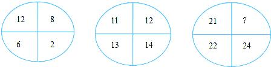

# Mathematics (Grade 3)

**ID**: ad20f98f
**难度**: medium_hard
**题型**: multiple_choice

## 题目
图中间问号处应为（  ）

A．22
B．23
C．24
D．25

## 解答

**答案**: B

1. Step1:观察前两个图形，发现规律为相对的两个数字的和相等，即12+2=6+8，11+14=12+13
2. Step2:根据上述规律，对于第三个图形可得21+24=22+？
3. Step3:计算？的值，？=21+24 - 22=45 - 22=23
4. Step4:得出答案为23，对应选项B

## 知识点

**知识点**:
  - 数表中的规律．

---
