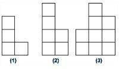

# Mathematics (Grade 3)

**ID**: af706aa1
**难度**: medium_hard
**题型**: multiple_choice

## 题目
有一些大小相同的正方形木块堆成一堆，从上往下看是图（1），从前往后看是图（2），从左往右看是图（3），这堆木块共有（  ）块．

A．9
B．10
C．11
D．12

## 解答

**答案**: C

1. Step1:根据图形的三视图可知，图形有2列，3行。
2. Step2:确定左边一列第一行有3个小正方体。
3. Step3:确定左边一列第二行有4个小正方体。
4. Step4:确定左边一列最后一行有2个小正方体。
5. Step5:确定右边一列靠最前面有1行，是2个小正方体。
6. Step6:计算木块总数为3 + 4 + 2 + 2 = 11块。

## 知识点

**知识点**:
  - 从不同方向观察物体和几何体．

---
