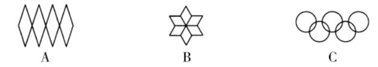

# Mathematics (Grade 3)

**ID**: b06e1fa1
**难度**: medium_hard
**题型**: multiple_choice

## 题目
下面三个图形中，不能通过平移基本图形得到的是（）

## 解答

**答案**: B

1. Step1:明确平移的定义，即在平面内，将一个图形沿某个方向移动一定的距离，这样的图形移动就叫作图形的平移
2. Step2:观察选项A中的图形，发现其可以通过平移基本图形得到
3. Step3:观察选项B中的图形，发现其是通过旋转得到，不能通过平移基本图形得到
4. Step4:观察选项C中的图形，发现其可以通过平移基本图形得到
5. Step5:得出不能通过平移基本图形得到的图形是B

## 知识点

**知识点**:
  - 平移;图形的旋转

---
