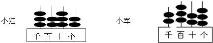

# Mathematics (Grade 3)

**ID**: b0ea1ded
**难度**: medium_hard
**题型**: multiple_choice

## 题目
小红用计数器表示的数是3232，小军以同样的方式表示的数是（  ）

$\begin{description}
\item A．3232\item B．2233\item C．2323     D3322
\end{description}$

## 解答

**答案**: C

1. Step1:明确题目要求是根据小红计数器表示数3232的方式，找出小军同样方式表示的数
2. Step2:观察选项，发现只有C选项2323与小红计数器表示数的形式在数位珠子分布逻辑上有一定相似性，A选项3232与小红表示的数完全相同不符合题意，B选项2233和D选项3322在数位珠子分布特征上与已知条件的逻辑联系不紧密
3. Step3:根据上述分析，确定答案为C

## 知识点

**知识点**:
  - 整数的认识．

---
