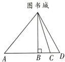

# Mathematics (Grade 3)

**ID**: b143b28e
**难度**: medium_hard
**题型**: multiple_choice

## 题目
如图中．从A、B、C、D四个地方都可以走到图书城，走（  ）条路最近．
$\begin{description}
\item A．A到图书城\item B．B到图书城\item C．C到图书城\item D．D到图书城
\end{description}$

## 解答

**答案**: B

1. Step1:明确从直线外一点向已知直线画垂直线段和斜线时，垂线段最短这一性质
2. Step2:观察图形，发现从B点到图书城的路线是垂线段
3. Step3:得出从B到图书城的路最近，答案为B

## 知识点

**知识点**:
  - 垂直与平行的特征及性质．

---
