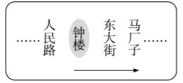

# Mathematics (Grade 3)

**ID**: b19a9e58
**难度**: medium_hard
**题型**: multiple_choice

## 题目
下面是5路公交车的站牌，由此可知，下一站是（）。

A.马厂子
B.东大街
C.人民路

## 解答

**答案**: B

1. Step1:观察5路公交车站牌，确定当前站点为钟楼
2. Step2:看到箭头指示方向
3. Step3:根据以钟楼为观测点，其右面是东大街，且箭头方向指向右面
4. Step4:得出钟楼的下一站是东大街，即答案为B

## 知识点

**知识点**:
  - 辨认方向

---
