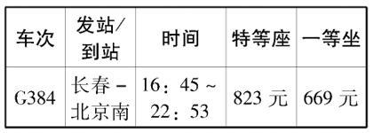

# Mathematics (Grade 3)

**ID**: b1d0c2e9
**难度**: medium_hard
**题型**: multiple_choice

## 题目
张叔叔和他的一位同事乘坐$\textit{G}$384次列车出差，他们去时买的都是特等座，回来时买的都是一等座．他们一共花了多少钱，列式正确的是(  )．

A．823＋669
B．823＋823
C．823＋669＋823＋669

## 解答

**答案**: C

1. Step1:分析去程花费，张叔叔和同事两人去时买特等座，特等座单价823元，所以去程花费为823×2元。
2. Step2:分析回程花费，两人回来时买一等座，一等座单价669元，所以回程花费为669×2元。
3. Step3:计算总共花费，将去程和回程花费相加，即823×2 + 669×2 = 823＋669＋823＋669，所以列式正确的是C选项。

## 知识点

**知识点**:
  - 小学数学;数与代数;应用题;简单应用题

---
