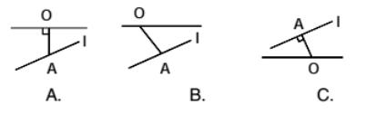

# Mathematics (Grade 3)

**ID**: ba0f7cdb
**难度**: medium_hard
**题型**: multiple_choice

## 题目
图（）中线段OA的长度表示点O到直线l的距离。

## 解答

**答案**: C

1. Step1:明确点到直线的距离的概念为直线外一点到这条直线的垂线段的长度。
2. Step2:分析图A，发现线段OA不与直线l垂直，根据概念可知线段OA不能表示点O到直线l的距离。
3. Step3:分析图B，发现线段OA不与直线l垂直，根据概念可知线段OA不能表示点O到直线l的距离。
4. Step4:分析图C，发现线段OA与直线l垂直，垂足为点A，根据概念可知线段OA能表示点O到直线l的距离。
5. Step5:综上，答案是C。

## 知识点

**知识点**:
  - 过直线上或直线外一点作直线的垂线

---
