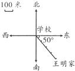

# Mathematics (Grade 3)

**ID**: bb78a316
**难度**: medium_hard
**题型**: multiple_choice

## 题目
王明家在学校_偏__的方向上，距离是_米．横线上依次应填(  )
A．东 南 50° 400
B．南 东 50° 400
C．东 南 30° 400
D．南 东 60° 400

## 解答

**答案**: A

1. Step1:根据'上北下南，左西右东'的辨别法确定观测方向，以学校为观测点
2. Step2:判断出王明家在学校东偏南50°方向
3. Step3:由图可知图上1格代表100米，王明家到学校有4格，计算距离为100×4 = 400米
4. Step4:根据前面的判断和计算，得出答案为选项A

## 知识点

**知识点**:
  - 根据方向和距离确定物体的位置．

---
