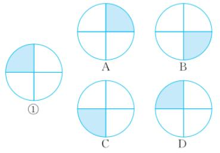

# Mathematics (Grade 3)

**ID**: bd840889
**难度**: medium_hard
**题型**: multiple_choice

## 题目
可由①平移得到的是（）。

## 解答

**答案**: D

1. Step1:明确平移的定义，即在平面内，将一个图形上的所有点都按照某个方向作相同距离的移动，且平移不改变物体的形状和大小
2. Step2:观察选项A，发现其图形与①图的形状或大小存在差异
3. Step3:观察选项B，发现其图形与①图的形状或大小存在差异
4. Step4:观察选项C，发现其图形与①图的形状或大小存在差异
5. Step5:观察选项D，发现其图形和①图的形状大小一致，符合平移的特征

## 知识点

**知识点**:
  - 平移

---
