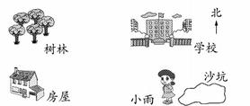

# Mathematics (Grade 3)

**ID**: c1168039
**难度**: medium_hard
**题型**: multiple_choice

## 题目
如下图，小雨站在沙坑边，她应该向（）方向走才能到达树林。

A.东南
B.西南
C.东北
D.西北

## 解答

**答案**: D

1. Step1:明确地图上的方向辨别方法为‘上北下南，左西右东’
2. Step2:观察图中沙坑和树林的位置关系
3. Step3:根据方向辨别方法，判断从沙坑到树林的方向为西北
4. Step4:得出小雨应向西北方向走才能到达树林，对应选项D

## 知识点

**知识点**:
  - 方向与位置

---
