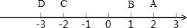

# Mathematics (Grade 3)

**ID**: c832c9b5
**难度**: medium_hard
**题型**: multiple_choice

## 题目
如图，数轴上的点A、B、C、D中，表示互为相反数的两个点是（  ）
A．点A和点D
B．点A和点C
C．点B和点C
D．点B和点D

## 解答

**答案**: B

1. Step1:明确任务是找出数轴上表示互为相反数的两个点
2. Step2:根据数轴确定点A表示的数是2
3. Step3:根据数轴确定点B表示的数是1
4. Step4:根据数轴确定点C表示的数是-2
5. Step5:根据数轴确定点D表示的数是-3
6. Step6:依据相反数的定义，判断出2和-2互为相反数
7. Step7:得出表示互为相反数的两个点是点A和点C

## 知识点

**知识点**:
  - 数轴的认识．

---
