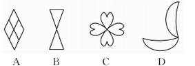

# Mathematics (Grade 3)

**ID**: c97046fe
**难度**: medium_hard
**题型**: multiple_choice

## 题目
下面的图案能通过自身的一部分平移得到的是（）。

## 解答

**答案**: A

1. Step1:明确平移的性质为只改变图形的位置，而不改变图形的形状和大小
2. Step2:分析A选项，其平移后图形的形状和大小不变，符合平移性质
3. Step3:分析B选项，其图形需要通过旋转才能得到，不符合平移要求
4. Step4:分析C选项，其图形需要通过旋转才能得到，不符合平移要求
5. Step5:分析D选项，其图形需要通过旋转才能得到，不符合平移要求
6. Step6:综上，能通过自身一部分平移得到的图案是A选项

## 知识点

**知识点**:
  - 用平移变换作图;平移的定义

---
