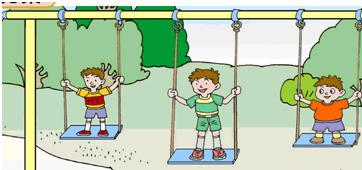

# Mathematics (Grade 3)

**ID**: c990d411
**难度**: medium_hard
**题型**: multiple_choice

## 题目
在相同的时间内谁荡（  ）次数多

$\begin{description}
\item A．小明\item B．小亮\item C．小华
\end{description}$

## 解答

**答案**: A

1. Step1:明确在相同时间内，同一个秋千（摆长不变）荡的次数不变且与重量无关，绳子长度与荡的次数关系为绳子越长，周期越大，频率越小，次数越少。
2. Step2:观察图片，判断出小明所在秋千的绳子最短。
3. Step3:根据上述关系得出在相同时间内小明荡的次数最多，所以答案选A。

## 知识点

**知识点**:
  - 旋转．

---
