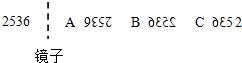

# Mathematics (Grade 3)

**ID**: d4816d23
**难度**: medium_hard
**题型**: multiple_choice

## 题目
仔细观察下面的数字，从镜子中看左边的数字应是(  )

A．A
B．B
C．C

## 解答

**答案**: B

1. Step1:明确镜子成像的对称轴为竖直方向的直线
2. Step2:根据镜子成像特点，镜子中数字的顺序与实际数字顺序相反
3. Step3:观察选项，找出数字顺序与题目中数字顺序相反的选项为B

## 知识点

**知识点**:
  - 镜面对称．

---
