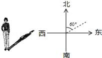

# Mathematics (Grade 3)

**ID**: d4d5cff5
**难度**: medium_hard
**题型**: multiple_choice

## 题目
如图，如果在阳光下你的影子位于你的北偏东60°方向，那么太阳相对于你的方向是（  ）
A．北偏东60°
B．北偏东30°
C．南偏西60°
D．南偏西30°

## 解答

**答案**: C

1. Step1:明确人相对于太阳与太阳相对于人的方位关系是正好相反
2. Step2:已知影子位于人的北偏东60°方向，此为太阳相对于人的相反方向
3. Step3:根据相反关系，得出太阳相对于人的方向是南偏西60°

## 知识点

**知识点**:
  - 方向．

---
