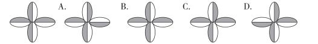

# Mathematics (Grade 3)

**ID**: d68c8d95
**难度**: medium_hard
**题型**: multiple_choice

## 题目
下图中，由已知图形通过平移变换得到的是（）

## 解答

**答案**: B

1. Step1:明确图形平移的性质为只改变图形的位置，不改变图形的形状和大小
2. Step2:观察选项A，发现其灰色部分与原图位置不同，不符合平移特征
3. Step3:观察选项B，其灰色部分与原图的位置一样，符合平移后图形位置改变但特征不变的性质
4. Step4:观察选项C，其灰色部分与原图位置不同，不符合平移特征
5. Step5:观察选项D，其灰色部分与原图位置不同，不符合平移特征
6. Step6:综上，通过平移变换得到的是图案B

## 知识点

**知识点**:
  - 平移

---
