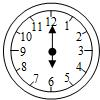

# Mathematics (Grade 3)

**ID**: d74285e9
**难度**: medium_hard
**题型**: multiple_choice

## 题目
钟面上表示的时间是（  ）
$\begin{description}
\item A．12时\item B．12时30分\item C．6时
\end{description}$

## 解答

**答案**: C

1. Step1:明确钟面分作12个大格，时针每过一个大格是1小时，分针每过一个大格是5分钟
2. Step2:观察发现时针指6，根据时针每过一个大格是1小时，可知此时是6时
3. Step3:看到分针指12，也就是0格，说明是整点
4. Step4:综合时针和分针的指向，得出钟面上表示的时间是6时整，所以答案选C

## 知识点

**知识点**:
  - 时、分、秒及其关系、单位换算与计算．

---
