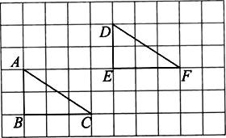

# Mathematics (Grade 3)

**ID**: d825ca58
**难度**: medium_hard
**题型**: multiple_choice

## 题目
如图，△$\textit{ABC}$经过怎样的平移可以得到△$\textit{DEF}$？(    )

$\begin{description}
\item A．把△\textit{ABC}向左平移4格，再向下平移2格\item B．把△\textit{ABC}向右平移4格，再向下平移2格\item C．把△\textit{ABC}向右平移4格，再向上平移2格\item D．把△\textit{ABC}向左平移4格，再向上平移2格
\end{description}$

## 解答

**答案**: C

1. Step1:观察图形中△ABC 和△DEF 对应点的位置关系，先看点 A 与点 D 的位置变化。
2. Step2:发现点 A 到点 D 是在水平方向上向右移动了 4 格。
3. Step3:再看在垂直方向上，点 A 到点 D 是向上移动了 2 格。
4. Step4:根据对应点的平移规律，可知整个△ABC 向右平移 4 格，再向上平移 2 格可以得到△DEF，所以答案选 C。

## 知识点

**知识点**:
  - 小学数学;图形与几何;图形与变换;平移与平移现象

---
