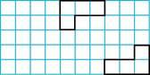

# Mathematics (Grade 3)

**ID**: dd04f60c
**难度**: medium_hard
**题型**: multiple_choice

## 题目
将方格纸上面的图形平移,使其与下面的图形拼成一个长方形,正确的平移方法是(  )。

$\begin{description}
\item A．先向下平移2格,再向左平移3格\item B．先向下平移2格,再向右平移3格\item C．先向下平移3格,再向左平移2格\item D．先向下平移3格,再向右平移2格
\end{description}$

## 解答

**答案**: D

1. Step1:观察上方图形与下方图形的位置关系，要拼成一个长方形，需确定上方图形的平移方向和格数。
2. Step2:先考虑上下方向的平移，发现上方图形需向下平移3格才能与下方图形在垂直方向上对齐。
3. Step3:再看左右方向的平移，经过分析可知向下平移3格后，还需向右平移2格才能与下方图形拼成一个长方形。
4. Step4:逐一分析选项，A选项先向下平移2格，再向左平移3格不符合要求；B选项先向下平移2格，再向右平移3格不符合；C选项先向下平移3格，再向左平移2格也不符合；D选项先向下平移3格，再向右平移2格符合推导结果。

## 知识点

**知识点**:
  - 

---
